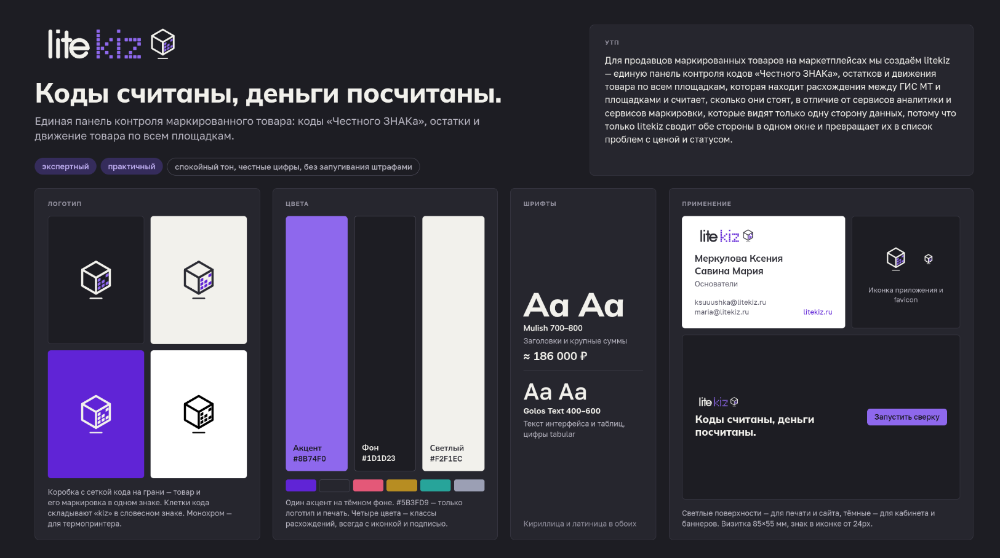

# Облачный сервис для продавцов маркированных товаров на маркетплейсах litekiz

Единая панель контроля маркированного товара: коды «Честного ЗНАКа», остатки и движение товара по всем площадкам. 
Сервис сопоставляет коды в ГИС МТ с реальными остатками на площадках, находит четыре типа расхождений — коды без товара, товар без кодов, зависшие и невозвращённые в оборот коды — и считает, 
во сколько обходится каждое. Все кабинеты, единый справочник товаров и сроки ключей — в одном окне. 
Полный цикл (заказ кодов, печать, ввод и вывод из оборота, УПД) сервис не закрывает: он дополняет сервисы маркировки, а не заменяет их.

## Brandboard

